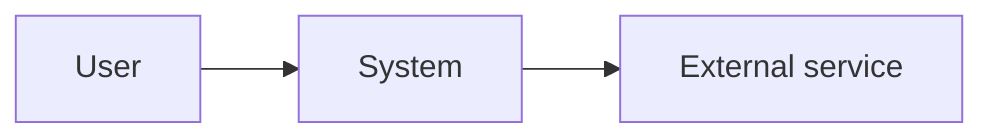
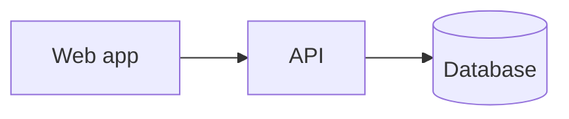
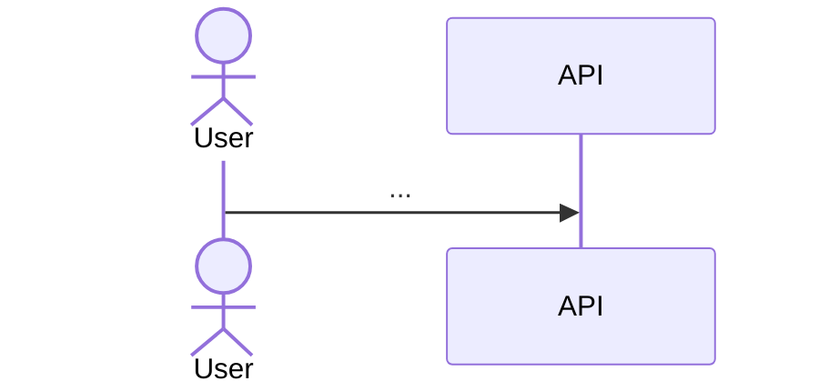

# Architecture Document: <Product>

**Status:** Draft | Baselined  **Version:** 0.1  **Date:** YYYY-MM-DD
**Inputs:** REQ-NNNN, features.md, journeys, wireframes, standards, threat model, approvals

## 1. Context & scope
## 2. Quality goals (from NFRs)
| Goal | Target | Source |
|---|---|---|

## 3. Constraints
## 4. System context (C4 level 1)

## 5. Containers (C4 level 2)

## 6. Components
| ID | Component | Responsibility | Tech | Features |
|---|---|---|---|---|

## 7. Runtime flows (one per user journey)

## 8. Deployment & environments
## 9. Cross-cutting: authn/authz, logging, monitoring, errors, config, caching, i18n
## 10. Security: threat mitigations
| Threat | Mitigation | Where (component/API/data) |
|---|---|---|

## 11. Standards compliance
| Standard | How satisfied | Deviation ADR |
|---|---|---|

## 12. Decisions (ADR index)
| ADR | Title | Status |
|---|---|---|

## 13. Traceability matrix
| Feature / AC | Components | APIs | Entities | Screens |
|---|---|---|---|---|

## 14. Risks & open issues
