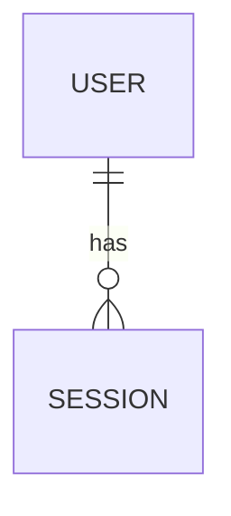

# Data Model: <Product>

**Version:** 0.1  **Date:** YYYY-MM-DD  **Store(s):** e.g. PostgreSQL 16 (ADR-0002)

## Entity relationship diagram

## Entities
### USER
| Attribute | Type | Constraints | PII | Notes |
|---|---|---|---|---|
| id | uuid | PK | no | |
| email | citext | unique, not null | yes | |

Indexes: ...   Retention: ...   Features: F-01

## Data classification & retention
| Entity | Classification | Encryption | Retention | Deletion rule |
|---|---|---|---|---|

## Migrations & seed data
