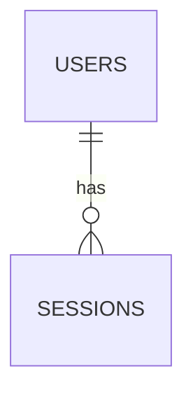

# Database Schema
**Version:** 0.1  **Date:** YYYY-MM-DD  **Engine:** <e.g. PostgreSQL 16> (ADR-NNNN)  **Data Model:** vX
**Migration tool:** <tool>  **Latest migration:** <id>  **Skills used:** db-x vX.Y

## Overview

## Tables
### users
| Column | Type | Null | Default | Constraints | PII / protection | From Data Model |
|---|---|---|---|---|---|---|
| id | uuid | no | gen_random_uuid() | PK | - | USER.id |
| email | citext | no | | UNIQUE | PII / encrypted at rest (disk) | USER.email |
| created_at | timestamptz | no | now() | | - | USER.createdAt |

Foreign keys: ...   Checks: ...   Indexes: see Indexing Notes (IX-NN)
Row-level security / tenancy: ...   Retention: ...

## Physical decisions & deviations from the logical model
| Decision | Reason | Alternative rejected |
|---|---|---|

## PII & retention summary
| Table.column | Classification | Protection | Retention | Deletion mechanism |
|---|---|---|---|---|

## Partitioning / archiving
## Enums & reference data
## Change log
