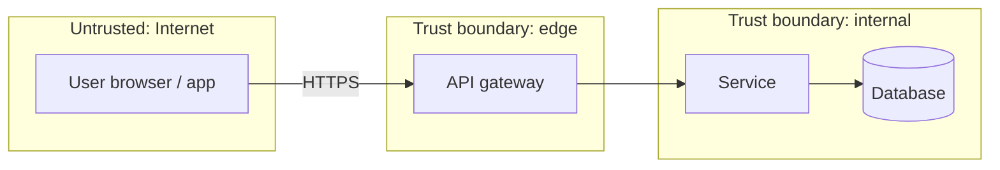

# Threat Model: <Product>
**Version:** 0.1  **Date:** YYYY-MM-DD  **Architecture:** vX  **Covers RC:** <version>  **Skills used:** sec-x vX.Y

## Scope & assumptions
## Assets
| Asset | Classification (public/internal/confidential/restricted) | Why it matters | Obligations |
|---|---|---|---|

## Actors & entry points
| Actor | Trust level | Entry points |
|---|---|---|

## Data-flow diagram & trust boundaries

## Threats (STRIDE + abuse cases + privacy)
| ID | Element / flow | Category | Threat | Likelihood | Impact | Risk | Required mitigations (testable) | Obligations | Status |
|---|---|---|---|---|---|---|---|---|---|
| T-01 | POST /v1/sessions | Spoofing | credential stuffing | High | High | High | rate limit per IP+account, MFA option, breached-password check | OB-02 | open |

## Abuse cases (per critical journey)
## Privacy threats (linkability, identifiability, data minimization, retention, consent)
## Compliance mapping
See `compliance-matrix.md` section in this document or a linked file.
## Accepted risks
| RA | Threat | Reason | Accepted by (human) | Expires |
|---|---|---|---|---|
## Change log
