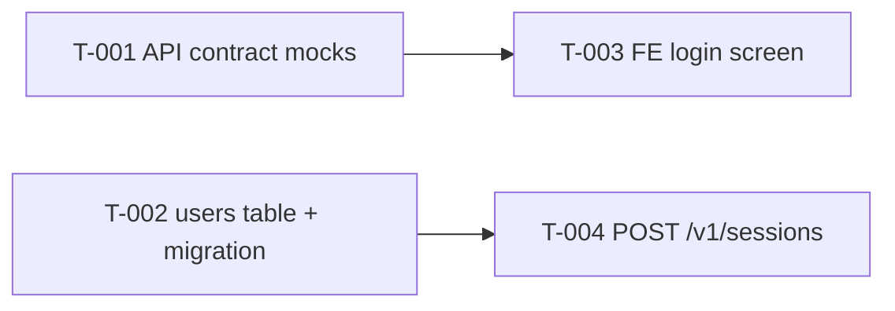

# Technical Task Breakdown

**Date:** YYYY-MM-DD  **Inputs:** architecture vX, API contracts vX, standards, backlog vX
**Skills used:** tl-x vX.Y

## Milestones
| Milestone | Backlog items | Goal |
|---|---|---|

## Dependency order

## Tasks
### B-01 <backlog item> (priority 1)
| Task | Track | Description | Touches (component / API / entity) | Depends on | Est. | Suited for | Acceptance checks | Guidelines |
|---|---|---|---|---|---|---|---|---|
| T-001 | BE | ... | C-02 / POST /v1/sessions / SESSION | - | M | AI agent (well-specified CRUD) | AC-01.1, contract tests pass | G-BE-02, G-API-01 |

## Parallel tracks
Which tasks can start now, per track.

## Gaps & risks
Backlog items the architecture/contracts don't cover yet → feedback for the architect.
